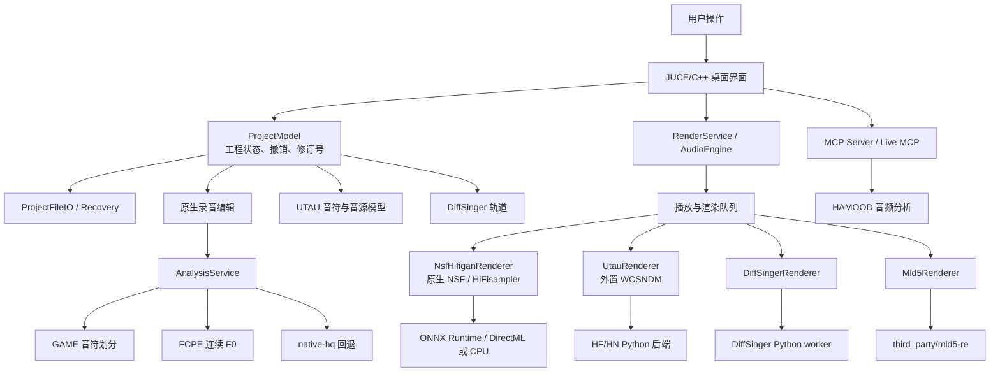

# HachiShifter 项目功能与架构说明

本文档面向需要理解、构建、维护或扩展 HachiShifter 的开发者，基于当前 GitHub `dev` 源码快照整理。

当前源码身份：

- 公开标签：`dev`
- 内部数值版本：`0.0.0`
- 当前内部更新：207
- 当前提交：`0e0f9137acd568d8d511e7fbe83a149176602583`
- 外置 WCSNDM：`0.0803`
- 构建入口：根目录 `CMakeLists.txt`
- 主源码目录：`src/`

当前目录是**源码开发版**，不是完整便携运行包。大型模型、编译产物、用户工程、音源库和部分 Python 运行环境不随源码 Git 仓库提供。完整运行包另见 `HachiShifter-0.27-Windows-x64-20261027` 目录。

## 1. 项目定位

HachiShifter 是一个 Windows 桌面音频编辑器，目标是把真人录音编辑、UTAU 音源合成、HiFisampler/NSF 神经合成和 DiffSinger 歌声合成放进同一个工程模型中。

它同时处理三类数据：

1. **乐谱数据**：音符、歌词、MIDI 中心音高、节拍、速度、拍号、轨道和表达参数。
2. **源音频数据**：录音文件、源文件范围、OTO/HJM 素材标注、原始 F0、音频时钟和源到目标的时间映射。
3. **渲染数据**：当前目标音高、响度和 FLAG 曲线、发音/音素时序、后端请求、渲染音频和缓存身份。

核心原则是让这三类数据保持可追溯关系：用户编辑的目标曲线不能被重新分析悄悄覆盖；分析结果不能冒充用户创作；渲染缓存不能在工程或模型身份变化后误复用；源 WAV、MPD、OTO 等外部文件默认保持原样。

## 2. 总体架构



主程序是 C++20/JUCE 应用。界面、工程模型、音频调度和主要后端集成在同一进程；部分神经模型和外部引擎以独立进程运行，用文件协议、标准输入输出或本机 TCP 交换任务。

## 3. 目录结构

### 3.1 顶层目录

| 路径 | 职责 |
|---|---|
| `src/` | 主程序、界面、工程模型、渲染器、分析器、MCP 和测试入口 |
| `src/backend/` | 音频后端、工程导入导出、UTAU、DiffSinger、分析和渲染服务 |
| `engines/` | DiffSinger 桥接源码、发音数据以及外部引擎相关源码；完整包中还包含运行时和模型 |
| `resources/` | 图标、语言文件、应用资源 |
| `assets/` | 工具栏图标等应用静态资源 |
| `third_party/` | 第三方库、适配代码和许可证 |
| `docs/` | 架构、接口、维护、构建、后端和更新记录 |
| `tests/` | Python 测试、后端专项测试和真实模型测试入口 |
| `tools/` | 构建、打包、模型或后端辅助脚本 |
| `cmake/` | Windows/MSVC/MSYS2 等构建工具链文件 |
| `CMakeLists.txt` | 当前开发版构建入口 |

### 3.2 主程序模块

- `Main.cpp`：应用入口、命令行诊断、专项 smoke 入口和主窗口启动。
- `MainComponent.*`：主界面生命周期、工程打开/保存、菜单、轨道交互和任务调度接线。
- `TimelineComponent.*`：时间轴、滚动、缩放和节拍显示。
- `PianoRollComponent.*`：钢琴卷帘、音符和音高/响度/FLAG 标点编辑。
- `TrackListComponent.*`：轨道创建、排序、模式和音源选择。
- `AssetManagerComponent.*`：素材文件夹、录音、音源和 OTO 资源管理。
- `SettingsComponent.*`：模型路径、后端、主题、语言和渲染偏好。
- `I18n.*`：外部 `lang/translations.tsv` 语言资源加载。

## 4. 工程模型与持久化

### 4.1 ProjectModel 是唯一工程状态入口

`ProjectModel` 保存工程的权威状态，负责：

- 工程基本信息、轨道和音符。
- 音符位置、长度、歌词、MIDI 中心音高。
- 原始 F0、目标音高曲线、响度、颤音和 FLAG。
- 普通音频片段、源文件范围、源时钟和音频身份。
- UTAU 音源、OTO 区域、CVVC 分段和发音信息。
- DiffSinger 音源、语言、音色、词典、音素和参数曲线。
- HAMOOD 工程数据、素材绑定和后端设置。
- 工程修订号、一次性编辑事务和撤销/重做历史。

编辑器界面不应直接拼装新的工程状态。新的编辑操作应通过 `ProjectModel` 的 setter/事务入口提交，以确保撤销、渲染失效、保存和 MCP 读取使用同一份权威数据。

### 4.2 工程格式

- `.hjpx`：JUCE ValueTree 二进制工程格式，是当前原生工程的主要格式。
- `.hspx`：旧版工程格式，读取时经过兼容路径。
- `.hjm`：素材侧注释/标注文件，保存源素材相关信息，不是完整工程快照。
- `.ust` / `.ustx`：UTAU 和 OpenUTAU 工程导入。
- `.mid` / `.midi`：MIDI 导入导出，保留轨道、歌词、速度和拍号可表达的信息。
- `.mpd`：Melodyne 工程导入，经过 `MelodyneImporter` 转换为现有原生工程模型。
- WAV/FLAC 等录音：打开后生成原生音频轨道或绑定到 UTAU/HiFisampler 素材。

`ProjectFileIO` 负责临时文件、写后读回、完整性检查、备份和原子替换；`ProjectRecovery` 负责自动恢复快照和跨进程保存租约。保存失败时不能直接覆盖原工程。

### 4.3 源素材绑定

工程中的音频不是“文件路径加一个音符”这么简单，而是由多层身份组成：

- 源文件绝对路径和内容摘要。
- 源文件中的音频区域。
- 工程中的目标起点和目标时长。
- 源时钟到目标时钟的映射。
- OTO/HJM/素材登记身份。
- 音符、音素和源区域之间的稳定 ID。

因此，移动、拉伸、裁剪、分割、连接和素材替换都必须经过源范围与音频身份预检，不能仅凭别名、数组顺序或最近音符猜测绑定关系。

## 5. 编辑与渲染主流程

一次典型渲染请求可以抽象为：

1. UI 根据当前选区和工程修订号创建请求。
2. `ProjectModel` 生成不可变的轨道/音符/源素材快照。
3. `RenderService` 进行预检，确定后端、音频范围、目标时钟和缓存身份。
4. `PlaybackRenderQueue` 安排播放附近任务，取消过期任务。
5. 后端准备发音、音高、响度、FLAG、音素时序和源特征。
6. 对应渲染器调用原生 DSP、ONNX Runtime、WCSNDM 或 Python worker。
7. 返回 WAV、元数据、警告和后端报告。
8. `AudioEngine` 播放或混音；需要导出时由导出入口写出 WAV。
9. 只有在请求仍对应当前工程修订号时，结果才会发布到工程或缓存。

渲染结果不能反向覆盖用户尚未提交的编辑。异步任务完成后必须检查请求身份、工程修订号、音符 ID 和源文件摘要。

## 6. 原生录音编辑

原生音频轨道用于编辑真人录音或普通音频素材，主要实现位于：

- `NativeAudio*`
- `NativeNoteTiming.*`
- `NativeTrimSource.*`
- `NativeSourceTimeMap.*`
- `NativeSharedEnvelope.*`
- `NativeUnpitchedRegions.*`
- `NativeNoteJoin.*`
- `NativeVirtual*`

支持的操作包括：

- 移动、拉伸、自由裁剪和向源文件边界扩展。
- 分割、连接、重叠控制和源边界交接。
- 手绘/直线/贝塞尔音高曲线。
- 响度包络和颤音。
- 原始 F0 与目标音高分离显示。
- 无音高区域的保守标记。
- 同源多音符的连续时钟和共享曲线。
- 虚拟连接、源贡献窗口和连接音过渡。

“无音高”表示当前区域缺少可编辑的音高对象，不表示模型已经识别出背景噪声或清音。渲染时这类区域保持零 F0 或原音保护语义。

## 7. 源音频分析

入口主要是 `backend/AnalysisService.*`、`GameAnalyzer.*`、`FcpeAnalyzer.*` 和 `NativeAnalyzer.*`。

### 7.1 GAME + FCPE

- GAME 负责音符划分和逐音符音高。
- FCPE 负责连续 F0，覆盖滑音、颤音和音符内部走势。
- 缺失模型或推理失败时回退到 `native-hq`。
- `--inspect-analysis` 和 MCP `analysis_status` 用于确认实际模型路径和后端。
- 分析线程受限，避免多个 ONNX 会话抢占 UI 和音频线程。

默认查找：

```text
models/game/medium
models/fcpe/fcpe.onnx
```

GAME/FCPE 结果是源事实。它们可以被目标音高编辑消费，但不能覆盖已经明确保存的用户目标曲线。

### 7.2 Melodyne/MPD

`MelodyneImporter` 负责 MPD 文件读取和保守转换，`MelodyneProvider` 负责安装发现和可用性诊断。检测到 Melodyne 安装不等于获得完整 ARA 工程访问能力。

当前 MLD5 生产路径由 `Mld5Renderer` 和 `third_party/mld5-re` 提供独立 DSP。更新 205-207 重点修复了：

- 连续源的整段合成和切片回切。
- 同源 touching-join 的重复淡出/断音。
- 稀疏 property 被误判为无声区域。
- 旧 HJPX 缺少源音高字段时的证据门控恢复。

这些逻辑不会把不稳定的源音高候选强行写回作者数据，也不等价于完整 Melodyne 声学一致性。

## 8. UTAU 与音源系统

### 8.1 音源和 OTO

`UtauRenderer`、`SampleSettings`、`AssetManagerComponent` 和 `OtoWaveformEditorComponent` 共同负责：

- 音源目录登记和成员枚举。
- `oto.ini`、界/谋模式 OTO 读取。
- alias、offset、consonant、cutoff、preutterance、overlap。
- 普通音符和 CVVC 音素的源区域映射。
- OTO 波形预览和编辑。
- 音源选择、拖拽加载和工程音源引用。

素材管理器只登记路径和文件，不为统计目的重复解码全部 WAV；真正渲染时按需读取 OTO 和音频。

### 8.2 中文 CVVC

`ChineseCvvcPhonemizer.h` 是 OpenUtau 中文 CVVC 规则的 C++ 适配，不是完整 OpenUtau 插件运行环境。它结合本项目自己的 OTO 查询、时间/音高/包络模型和拼音表，处理：

- CV、VC、句首和句尾。
- 前后缀 alias。
- 缺失 CV 的诊断和静音策略。
- 保留父音符所有权。
- 普通 UTAU 与 HiFisampler 共用的音素时钟。

生成的音素是渲染规划结果，不能无条件写回作者乐谱。

### 8.3 外置 WCSNDM

完整便携包中的 `engines/WCSNDM.exe` 是外部 UTAU 重采样引擎，当前版本 `0.0803`。它负责传统 UTAU/神经 HF/HN FLAG 路径，主程序通过 `UtauRenderer` 提交音符级渲染任务。

WCSNDM 的内核选择、FLAG 优先级和 HN1 限制见完整包中的 `engines/README.txt` 与 `engines/HN模式说明.md`。源码开发版不把 WCSNDM 的完整编译工程作为主项目源码的一部分。

## 9. NSF/HiFisampler 渲染

### 9.1 NsfHifiganRenderer

`backend/NsfHifiganRenderer.*` 是主程序内的 NSF-HiFiGAN 路径，使用 ONNX Runtime 加载 PC-NSF-HiFiGAN 模型。完整运行包的典型模型目录为：

```text
models/nsf_hifigan/pc_nsf_hifigan.onnx
models/nsf_hifigan/config.json
models/nsf_hifigan/hifisampler.json
models/nsf_hifigan/hnsep/model.onnx
```

典型声学网格为 44.1 kHz、128 Mel、FFT 2048、hop 512。渲染过程中，源音频先按完整录音进行特征准备，再按 OTO/音符时间映射取帧；不能只对目标裁剪片段凭空补上下文。

### 9.2 HiFisampler FLAG

HiFisampler 支持独立的 `HIFI:*` FLAG 曲线，例如 `HIFI:g`、`HIFI:Hb`、`HIFI:Hv`、`HIFI:Ht`、`HIFI:HG`、`HIFI:P`、`HIFI:t` 和 `HIFI:A`。这些参数保留原生单位，不应套用 WCSNDM FLAG 的单位换算。

普通 UTAU FLAG、HiFisampler FLAG、响度包络和音高曲线属于不同参数域，但最终在统一的渲染请求中汇合。

### 9.3 HN-SEP

HN-SEP 是 HN1 实验路径的一部分：

1. 从完整原始录音中提取谐波波形。
2. 对谐波波形做 STFT 并按源时间映射重采样。
3. 由现有 FLAG 数学计算谐波谱增益。
4. LLSM 继续提供非谐波/噪声功率。
5. 在功率域合并后生成 Mel，再送入 NSF 声码器。

HN 缓存按源 PCM、模型字节、配置和声学网格哈希；缓存命中不能跨不同源内容或不同模型版本误用。HN1 只接入有限的谐波参数，不能描述为完整原始波形重建。

## 10. DiffSinger

DiffSinger 是独立的歌声合成轨道，主程序通过 `backend/DiffSingerRenderer.*` 调用 `engines/diffsinger/bridge.py`。

### 10.1 请求操作

桥接层支持：

- `inspect`：音源和模型预检。
- `phonemize`：歌词/词典转音素。
- `timing`：音素时长和辅音/元音时间规划。
- `pitch`：预测音高曲线。
- `parameters`：预测能量、气声、张力、实声等 variance 参数。
- `render`：生成 WAV、音素元数据和参数曲线。

### 10.2 Python worker 生命周期

`engines/diffsinger/runtime.py` 使用工程临时目录作为轻量协议目录：

```text
ready.json       worker 启动完成
request.json     主程序提交请求
result.json      worker 写回结果
*.wav            渲染结果
```

worker 会检查父进程是否存活，默认空闲一段时间后释放模型。音频、计划和 variance 预测均有有界缓存；模型配置、音源文件和请求结构变化会使缓存失效。

### 10.3 局部 retake

局部重算必须保留未选区域的上下文：

- 选中音符重新计算。
- 未选音符的 pitch/参数作为锁定上下文。
- 如果模型没有 `retake` 或参数上下文输入，则明确报错或自动回退整句，并在结果中记录 warning。
- 局部结果不能覆盖未选择音符的工程数据。

完整 DiffSinger 音源、声码器和部分模型依赖由用户提供，源码包不包含全部第三方声库。

## 11. HAMOOD 与伴奏分析

HAMOOD 位于 `src/Hamood.*`、`src/HamoodAudio.*`、`src/MainComponentHamood.*` 和 `tools/hamood_audio/`。

它是伴奏分析旁路，不改变原伴奏 PCM。主要能力：

- Beat This! small0：节拍和小节首拍。
- BTC 170 类：分段和弦、候选和未校准分数。
- CQT 低频音级：C-B 候选和相对强度，是启发式证据，不是独立贝斯转谱。
- BPM/变速估计。
- 基于和弦的和声声部预览和生成。

分析结果按音频内容和模型哈希缓存到工程旁。分析失败时返回错误，不伪造和弦结果。BPM、拍点和和弦都应视为辅助证据，不能自动覆盖工程速度或替代人工配器。

## 12. MCP 与自动化接口

MCP 服务由 `src/backend/McpServer.*`、`src/backend/LiveMcpBridge.*`、`src/MainComponentMcp.cpp` 等组成。

接口分为两类：

### 12.1 无界面工程 MCP

用于：

- 新建、打开、保存工程。
- 导入音频、MIDI、UST/USTX、MPD。
- 读取工程、轨道、音符和选区。
- 修改音符、音高、包络、FLAG 和音源绑定。
- 渲染、播放、导出 WAV/MIDI。
- 读取/写入 OTO 和素材注册。
- 调用 HAMOOD 分析和生成流程。

### 12.2 当前窗口 Live MCP

连接正在运行的编辑器窗口，读取实时选区、当前未保存状态和 UI 所在工程。它不能把“读取选区”退化为读取磁盘工程，也不能用失败路径探测用户目录。

所有会改变工程的 MCP 操作都应带有修订号或预期版本检查，并遵循同一套 `ProjectModel` 事务和撤销规则。

## 13. 缓存、异步和一致性

### 13.1 缓存身份

缓存身份通常组合以下内容：

- 工程/音符/音素结构。
- 源文件内容摘要、大小和修改时间。
- 模型文件和配置摘要。
- 采样率、FFT、hop、输出声道。
- 目标音高、FLAG、包络和时间映射。
- 后端版本和协议版本。

只改变文件路径不应必然导致内容缓存失效；改变实际 PCM、模型字节、工程结构或控制曲线必须使相关缓存失效。

### 13.2 任务取消

渲染队列会取消过期请求，但取消后不能发布残留的部分音频。ONNX 推理、Python worker、WCSNDM 和主线程之间都需要检查：

- 请求 ID。
- 工程 revision。
- 源音频 identity。
- 目标轨道/音符 identity。
- 后端是否仍是当前选择。

### 13.3 源文件保护

原始 WAV、MPD、OTO 和用户工程默认只读使用。写入工程旁缓存或新的导出目录时使用临时文件、校验和原子替换；注册素材和工程内标注不能隐式修改外部原始文件。

## 14. 构建与运行

### 14.1 构建要求

当前 Windows 构建通常需要：

- Visual Studio 2022 C++ 工具链。
- Windows SDK。
- Git。
- CMake 3.24 或更高版本。
- 网络访问，用于首次获取固定版本依赖。

基本构建命令：

```powershell
cmake -S . -B build -G "Visual Studio 17 2022" -A x64
cmake --build build --config Release --parallel 4
```

也可以使用：

```powershell
./build-local.ps1 -Reconfigure
```

### 14.2 源码包与完整运行包的区别

源码 `dev` 快照：

- 提供 C++ 源码、Python 桥接源码、文档、测试和构建脚本。
- 不提供大模型权重、完整便携 Python、用户音源和工程。
- 云构建默认生成轻量程序包。

完整 0.27 运行包：

- 提供 `HachiShifter Next.exe`、WCSNDM、Python、ONNX Runtime、模型和 DLL。
- 可直接运行，但不是当前 `dev` 源码的同一提交。
- UTAU/DiffSinger 声库和用户工程仍需自行提供。

将源码构建结果放入现有安装目录时，应保留与程序版本匹配的 `lang`、`engines`、模型和第三方许可文件；不要把开发目录中的绝对路径直接复制进便携配置。

## 15. 测试与验证

测试分为三层：

1. **纯逻辑测试**：工程模型、时间映射、曲线、序列化、缓存身份和错误拒绝。
2. **集成 smoke 测试**：实际启动主程序、打开工程、导入音频、调用后端和保存重开。
3. **真实模型/真实音频测试**：GAME/FCPE、NSF、HiFisampler、DiffSinger、HAMOOD、MLD5 和 WCSNDM。

常见入口以主程序参数形式提供，例如：

```text
--inspect-analysis
--smoke-game-defaults
--smoke-diffsinger
--smoke-diffsinger-timing
--smoke-hifisampler
--smoke-native-vibrato
--smoke-mld5-recovered
--smoke-hamood
```

测试报告通常写入 `test-output/`、`verification/` 或指定的输出目录。自动检查只能证明特定数据、模型和流程通过，不能直接等同于所有音源的听感结论。

## 16. 当前版本与维护边界

### 已明确的当前基线

- 当前源码公开标签是 `dev`，不是 0.27。
- 外置 WCSNDM 仍为 0.0803。
- 当前开发重点包含 MLD5 连续源、真实 F0 回落、同源连接断音修复、素材/源时钟一致性和 UTAU/DiffSinger 编辑修复。
- 代码和文档中的历史版本说明不能覆盖当前 `SOURCE_STATUS.md` 与最新提交。

### 需要谨慎处理的边界

- 不把 GAME/FCPE 的分析结果当作用户手工音高。
- 不把“无音高”当作背景噪声分类。
- 不凭文件名或 alias 猜测源素材身份。
- 不用缓存命中证明音频质量等价。
- 不把 HN1 解释成完整原始波形重建。
- 不把 DiffSinger 兼容层描述成完整 OpenUtau 插件环境。
- 不把 Melodyne 检测到安装描述成完整 ARA 可用。
- 不把自动测试数字扩展为所有第三方音源或人工听感保证。

## 17. 推荐阅读顺序

1. `docs/SOURCE_STATUS.md`：当前源码身份和开发边界。
2. `docs/AI_CODE_GUIDE.md`：按模块理解功能和维护约束。
3. `docs/AI_INTERFACE_ARCHITECTURE.md`：接口、数据流和权威入口。
4. `docs/AI_SOURCE_INDEX.md`：命令、文件和专项测试索引。
5. `src/ProjectModel.*`、`src/ProjectFileIO.*`：工程状态和持久化。
6. `src/backend/RenderService.*`、`src/AudioEngine.*`：渲染与播放调度。
7. `src/backend/UtauRenderer.*`、`src/backend/NsfHifiganRenderer.*`：UTAU/NSF 后端。
8. `src/backend/DiffSingerRenderer.*`、`engines/diffsinger/`：DiffSinger 桥接。
9. `src/backend/AnalysisService.*`、`src/GameAnalyzer.*`、`src/FcpeAnalyzer.*`：源音频分析。
10. `src/backend/McpServer.*`、`src/MainComponentMcp.cpp`：自动化接口。

维护新功能时，先确定它属于工程模型、分析、渲染请求、后端执行还是 UI 显示，再选择唯一权威入口。不要在界面层、缓存层或测试夹具中复制一套独立的数据语义。
